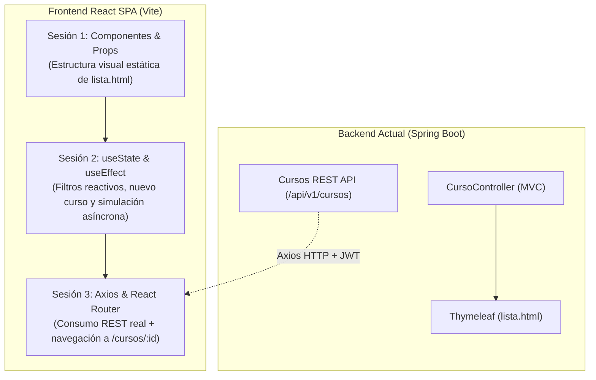

# Plan de Implementación Práctica: Migración de Gestión de Cursos (Thymeleaf MVC -> React SPA)

> **Contexto del Curso:** *Computación en Internet II (Universidad Icesi)*  
> **Backend Base:** `springboot` (Spring Boot 3/4, Spring Data JPA, Spring Security con JWT en `@Order(1)` y MVC en `@Order(2)`).  
> **Dominio de Trabajo:** Módulo de Gestión de Cursos (`Curso`, `Profesor`, `Matricula`).

---

## Estrategia Didáctica: "El Viaje de Migración"

Para maximizar el aprovechamiento de las **3 sesiones de 2 horas (6 horas)**, la práctica no empezará con una aplicación de juguete (como un contador aislado), sino con un caso real que los estudiantes ya conocen: **la migración de la interfaz Thymeleaf de Cursos (`/cursos-mvc/lista` y `formulario.html`) a una SPA en React**.



---

## Estrategia de Estilo Ultraligero (Sin distracciones en clase)

Para evitar que los estudiantes y el docente pierdan tiempo valioso escribiendo CSS o inline styles (`style={{ ... }}`) durante la codificación en vivo, se adopta una **hoja de estilos base centralizada (`src/index.css`)**.
- Los componentes de React se programan limpios, centrados 100% en la lógica de props, estado, hooks y peticiones HTTP.
- Los estilos se aplican mediante clases semánticas directas (`.navbar`, `.card`, `.grid-cursos`, `.btn`, `.input-search`, `.form-curso`).
- La apariencia visual es moderna, responsiva y utiliza la paleta institucional de Icesi (`#002855`, `#5454E9`).

---

## Estructura del Proyecto Frontend (`frontend-cursos/`)

Al finalizar las 3 sesiones, los estudiantes habrán construido de forma incremental la siguiente estructura:

```text
frontend-cursos/
├── index.html
├── package.json
├── vite.config.js
└── src/
    ├── main.jsx
    ├── App.jsx
    ├── index.css                # Estilos base universales (se configuran una sola vez)
    ├── api/
    │   └── axiosConfig.js       # (Sesión 3) Cliente HTTP centralizado
    ├── components/
    │   ├── Navbar.jsx           # (Sesión 1) Migración del fragments/layout.html
    │   ├── CursoCard.jsx        # (Sesión 1) Tarjeta por cada curso
    │   ├── CursoList.jsx        # (Sesión 1) Contenedor y mapeo (.map)
    │   └── CursoFiltro.jsx      # (Sesión 2) Búsqueda en tiempo real
    ├── pages/
    │   ├── CursosPage.jsx       # (Sesión 3) Vista general de catálogo
    │   ├── CursoDetallePage.jsx # (Sesión 3) Vista por ID con useParams()
    │   └── CursoFormPage.jsx    # (Sesión 3) Formulario con useNavigate()
    └── data/
        └── mockCursos.js        # (Sesión 1 y 2) Datos de respaldo inicial
```

---

## Sesión 1: "De Thymeleaf a Componentes React" (Vite, JSX y Props)

### Objetivo Práctico
Replicar la tabla y el navbar de [`lista.html`](file:///C:/Users/Alexo/Documents/ICESI/2026-2/COMPUNET_II/Repositorios/Code%20-%20AP%20-%20Compunet2-202620/springboot/src/main/resources/templates/cursos/lista.html) usando componentes funcionales y renderizado declarativo con `props`.

### Paso 1.1: Inicialización Limpia con Vite (10 min)
```bash
npm create vite@latest frontend-cursos -- --template react
cd frontend-cursos
npm install
npm run dev
```

Reemplazar el archivo `src/index.css` con esta hoja de estilos ultraligera (se copia una sola vez al inicio y no vuelve a tocarse):

```css
/* src/index.css — Estilos base ultraligeros */
:root {
  --primary: #002855;
  --accent: #5454E9;
  --success: #28a745;
  --danger: #dc3545;
  --bg-light: #f8fafc;
  --border: #e2e8f0;
  --text: #1e293b;
  --text-muted: #64748b;
}

body {
  margin: 0;
  font-family: system-ui, -apple-system, sans-serif;
  background-color: var(--bg-light);
  color: var(--text);
}

.container {
  max-width: 1000px;
  margin: 0 auto;
  padding: 1.5rem;
}

.navbar {
  background: var(--primary);
  color: #fff;
  padding: 1rem 2rem;
  display: flex;
  justify-content: space-between;
  align-items: center;
}

.navbar h2 {
  margin: 0;
  font-size: 1.25rem;
}

.grid-cursos {
  display: grid;
  grid-template-columns: repeat(auto-fill, minmax(280px, 1fr));
  gap: 1rem;
}

.card {
  background: #fff;
  border: 1px solid var(--border);
  border-radius: 8px;
  padding: 1rem 1.25rem;
  box-shadow: 0 1px 3px rgba(0,0,0,0.05);
}

.card h3 {
  margin: 0 0 0.5rem 0;
  color: var(--primary);
}

.card-subtitle {
  margin: 0.25rem 0;
  color: var(--text-muted);
  font-size: 0.9rem;
}

.card-profesor {
  margin: 0.5rem 0;
  font-size: 0.9rem;
  color: var(--text);
}

.btn {
  display: inline-block;
  padding: 0.4rem 0.8rem;
  border-radius: 4px;
  border: none;
  cursor: pointer;
  font-weight: 500;
  text-decoration: none;
}

.btn-primary { background: var(--accent); color: #fff; }
.btn-success { background: var(--success); color: #fff; }
.btn-danger { background: var(--danger); color: #fff; }
.btn-link { background: transparent; color: var(--accent); padding-left: 0; }

.input-search {
  width: 100%;
  padding: 0.6rem 0.8rem;
  border: 1px solid var(--border);
  border-radius: 6px;
  font-size: 0.95rem;
  box-sizing: border-box;
}

.form-curso {
  display: flex;
  flex-direction: column;
  gap: 1rem;
  max-width: 450px;
  background: #fff;
  padding: 1.5rem;
  border-radius: 8px;
  border: 1px solid var(--border);
}

.form-curso input {
  padding: 0.6rem 0.8rem;
  border: 1px solid var(--border);
  border-radius: 4px;
}

.status-box {
  padding: 0.75rem 1rem;
  border-radius: 6px;
  margin-bottom: 1rem;
}

.status-loading { background: #e0f2fe; color: #0369a1; }
.status-error { background: #fee2e2; color: #b91c1c; }
```

### Paso 1.2: Datos Mock Basados en el `data.sql` del Backend (5 min)
Crear `src/data/mockCursos.js` con la misma estructura que entrega el backend:
```javascript
export const MOCK_CURSOS = [
  {
    id: 1,
    nombre: "Computación en Internet II",
    creditos: 3,
    departamento: "Computación y Sistemas Inteligentes",
    profesor: "Kevin Rodriguez"
  },
  {
    id: 2,
    nombre: "Bases de Datos",
    creditos: 3,
    departamento: "Computación y Sistemas Inteligentes",
    profesor: "Claudia Martinez"
  },
  {
    id: 3,
    nombre: "Sistemas Distribuidos",
    creditos: 4,
    departamento: "TIC",
    profesor: "Andres Perez"
  }
];
```

### Paso 1.3: Construcción de Componentes (45 min)

#### A. `src/components/Navbar.jsx` (Migración de `layout.html`)
```jsx
export default function Navbar() {
  return (
    <nav className="navbar">
      <h2>Portal Cursos Icesi</h2>
      <div>
        <span style={{ marginRight: '1rem' }}>Docente Activo</span>
        <button className="btn btn-danger">Salir</button>
      </div>
    </nav>
  );
}
```

#### B. `src/components/CursoCard.jsx` (Componente de Presentación)
```jsx
export default function CursoCard({ curso }) {
  const { nombre, creditos, departamento, profesor } = curso;

  return (
    <div className="card">
      <h3>{nombre}</h3>
      <p className="card-subtitle">
        <strong>Créditos:</strong> {creditos} · <strong>Depto:</strong> {departamento}
      </p>
      <p className="card-profesor">
        <strong>Docente:</strong> {profesor || 'Sin profesor asignado'}
      </p>
      <div style={{ marginTop: '0.8rem' }}>
        <button className="btn btn-primary">Ver Detalle</button>
      </div>
    </div>
  );
}
```

#### C. `src/components/CursoList.jsx` (Renderizado de Listas)
```jsx
import CursoCard from './CursoCard';

export default function CursoList({ cursos }) {
  if (!cursos || cursos.length === 0) {
    return <p className="card-subtitle">No hay cursos registrados en el catálogo.</p>;
  }

  return (
    <div className="grid-cursos">
      {cursos.map((c) => (
        <CursoCard key={c.id} curso={c} />
      ))}
    </div>
  );
}
```

#### D. Integración en `src/App.jsx`
```jsx
import Navbar from './components/Navbar';
import CursoList from './components/CursoList';
import { MOCK_CURSOS } from './data/mockCursos';

export default function App() {
  return (
    <div>
      <Navbar />
      <main className="container">
        <h1>Catálogo de Asignaturas</h1>
        <CursoList cursos={MOCK_CURSOS} />
      </main>
    </div>
  );
}
```

### Contraste Pedagógico de Cierre (Sesión 1)
| Thymeleaf (`lista.html`) | React JSX (`CursoList.jsx`) |
| :--- | :--- |
| `<tr th:each="c : ${cursos}">` | `{cursos.map((c) => <CursoCard key={c.id} ... />)}` |
| `<td th:text="${c.nombre}">` | `<h3>{nombre}</h3>` |
| Servidor reconstruye el HTML en cada petición (SSR). | El navegador solo ejecuta la función y actualiza los nodos cambiados (Virtual DOM). |

---

## Sesión 2: "Memoria e Interactividad" (`useState` y `useEffect`)

### Objetivo Práctico
Dotar al catálogo de interactividad en tiempo real: búsqueda reactiva, registro de nuevos cursos con inmutabilidad y simulación de petición asíncrona de red con indicadores visuales de estado.

### Paso 2.1: Búsqueda Reactiva con `useState` (30 min)
Crear `src/components/CursoFiltro.jsx`:
```jsx
export default function CursoFiltro({ filtro, onFiltroChange }) {
  return (
    <div style={{ marginBottom: '1.5rem' }}>
      <input
        type="text"
        className="input-search"
        placeholder="Buscar curso o departamento..."
        value={filtro}
        onChange={(e) => onFiltroChange(e.target.value)}
      />
    </div>
  );
}
```

### Paso 2.2: Formulario de Nuevo Curso e Inmutabilidad (40 min)
Enseñar a los estudiantes por qué **mutar el array directamente (`cursos.push()`) no provoca re-render en React**:
```jsx
// En App.jsx
const [cursos, setCursos] = useState([]);
const [nuevoNombre, setNuevoNombre] = useState('');
const [nuevosCreditos, setNuevosCreditos] = useState(3);
const [nuevoDepto, setNuevoDepto] = useState('');

const handleAgregarCurso = (e) => {
  e.preventDefault();
  if (!nuevoNombre.trim()) return;

  const nuevo = {
    id: Date.now(),
    nombre: nuevoNombre,
    creditos: Number(nuevosCreditos),
    departamento: nuevoDepto,
    profesor: 'Profesor Pendiente'
  };

  // Inmutabilidad correcta: se crea un nuevo arreglo con spread operator
  setCursos((prevCursos) => [nuevo, ...prevCursos]);

  // Limpiar formulario
  setNuevoNombre('');
  setNuevoDepto('');
};
```

### Paso 2.3: `useEffect` y Ciclo de Vida con Carga Asíncrona (40 min)
Simular la latencia de un backend real para enseñar el patrón clásico de 3 estados (`data`, `isLoading`, `error`):
```jsx
import { useState, useEffect } from 'react';
import { MOCK_CURSOS } from './data/mockCursos';

// En App.jsx
const [cursos, setCursos] = useState([]);
const [isLoading, setIsLoading] = useState(true);
const [error, setError] = useState(null);

useEffect(() => {
  console.log("Montando componente: Simulando petición HTTP...");
  
  const timer = setTimeout(() => {
    // Simulamos respuesta exitosa
    setCursos(MOCK_CURSOS);
    setIsLoading(false);
  }, 1200);

  // Función de limpieza (cleanup)
  return () => clearTimeout(timer);
}, []); // Array vacio: se ejecuta únicamente una vez al montar
```

Render condicional en la interfaz:
```jsx
{isLoading && <div className="status-box status-loading">Cargando oferta académica desde el servidor...</div>}
{error && <div className="status-box status-error">Error: {error}</div>}
{!isLoading && !error && <CursoList cursos={cursosFiltrados} />}
```

---

## Sesión 3: "Consumo de APIs (Axios) y Navegación SPA (React Router)"

### Objetivo Práctico
Reemplazar los datos mock por peticiones HTTP reales hacia el backend Spring Boot (`/api/v1/cursos`) usando Axios, y dividir la aplicación en múltiples rutas (`/`, `/cursos/:id`, `/cursos/nuevo`) sin recargar la página.

### Paso 3.1: Configuración de Axios (`api/axiosConfig.js`) (25 min)
Instalación:
```bash
npm install axios
```

Archivo `src/api/axiosConfig.js`:
```javascript
import axios from 'axios';

const api = axios.create({
  baseURL: 'http://localhost:8080/api/v1',
  headers: {
    'Content-Type': 'application/json'
  }
});

// Interceptor para inyectar token JWT automáticamente (si se guardó en login)
api.interceptors.request.use((config) => {
  const token = localStorage.getItem('token');
  if (token) {
    config.headers.Authorization = `Bearer ${token}`;
  }
  return config;
});

export default api;
```

> [!IMPORTANT]
> **Configuración de CORS en Spring Boot:**  
> Recordar a los estudiantes que en [`SecurityConfig.java`](file:///C:/Users/Alexo/Documents/ICESI/2026-2/COMPUNET_II/Repositorios/Code%20-%20AP%20-%20Compunet2-202620/springboot/src/main/java/com/compunet/springboot/config/SecurityConfig.java) o con `@CrossOrigin(origins = "http://localhost:5173")` se debe autorizar el puerto de Vite para evitar el bloqueo del navegador.

Reemplazo en el `useEffect` del catálogo para consumo real:
```javascript
useEffect(() => {
  setIsLoading(true);
  api.get('/cursos')
    .then((res) => {
      setCursos(res.data);
      setError(null);
    })
    .catch((err) => {
      console.error(err);
      setError('No se pudo conectar con el servicio de Cursos');
    })
    .finally(() => setIsLoading(false));
}, []);
```

### Paso 3.2: Instalación y Configuración de React Router (45 min)
```bash
npm install react-router-dom
```

En `src/main.jsx`:
```jsx
import React from 'react';
import ReactDOM from 'react-dom/client';
import { BrowserRouter } from 'react-router-dom';
import App from './App';
import './index.css';

ReactDOM.createRoot(document.getElementById('root')).render(
  <React.StrictMode>
    <BrowserRouter>
      <App />
    </BrowserRouter>
  </React.StrictMode>
);
```

Definición de rutas en `src/App.jsx`:
```jsx
import { Routes, Route } from 'react-router-dom';
import Navbar from './components/Navbar';
import CursosPage from './pages/CursosPage';
import CursoDetallePage from './pages/CursoDetallePage';
import CursoFormPage from './pages/CursoFormPage';

export default function App() {
  return (
    <div>
      <Navbar />
      <main className="container">
        <Routes>
          <Route path="/" element={<CursosPage />} />
          <Route path="/cursos" element={<CursosPage />} />
          <Route path="/cursos/nuevo" element={<CursoFormPage />} />
          <Route path="/cursos/:id" element={<CursoDetallePage />} />
          <Route path="*" element={<h2>404: Página no encontrada</h2>} />
        </Routes>
      </main>
    </div>
  );
}
```

### Paso 3.3: Rutas Dinámicas con `useParams` e Historial con `useNavigate` (35 min)

#### A. Detalle de Curso (`src/pages/CursoDetallePage.jsx`):
Demuestra cómo leer el `:id` de la URL y consultar a la API:
```jsx
import { useParams, Link } from 'react-router-dom';
import { useState, useEffect } from 'react';
import api from '../api/axiosConfig';

export default function CursoDetallePage() {
  const { id } = useParams();
  const [curso, setCurso] = useState(null);
  const [loading, setLoading] = useState(true);

  useEffect(() => {
    api.get(`/cursos/${id}`)
      .then((res) => setCurso(res.data))
      .catch((err) => console.error(err))
      .finally(() => setLoading(false));
  }, [id]);

  if (loading) return <div className="status-box status-loading">Cargando detalle del curso #{id}...</div>;
  if (!curso) return <div className="status-box status-error">Curso no encontrado.</div>;

  return (
    <div>
      <Link to="/cursos" className="btn btn-link">Volver al Catálogo</Link>
      <h1>{curso.nombre}</h1>
      <p><strong>Créditos:</strong> {curso.creditos}</p>
      <p><strong>Departamento:</strong> {curso.departamento}</p>
      <div className="card" style={{ marginTop: '1rem' }}>
        <h4>Docente Titular</h4>
        <p>{curso.profesorNombreCompleto || curso.profesor || 'Docente Asignado'}</p>
        <p className="card-subtitle">{curso.profesorCorreo || 'docente@icesi.edu.co'}</p>
      </div>
    </div>
  );
}
```

#### B. Guardar y Redirigir con `useNavigate` (`src/pages/CursoFormPage.jsx`):
```jsx
import { useState } from 'react';
import { useNavigate } from 'react-router-dom';
import api from '../api/axiosConfig';

export default function CursoFormPage() {
  const navigate = useNavigate();
  const [nombre, setNombre] = useState('');
  const [creditos, setCreditos] = useState(3);
  const [departamento, setDepartamento] = useState('');

  const handleSubmit = async (e) => {
    e.preventDefault();
    try {
      await api.post('/cursos', { nombre, creditos: Number(creditos), departamento, profesorId: 1 });
      // Redirección imperativa al catálogo tras guardar exitosamente
      navigate('/cursos');
    } catch (err) {
      alert('Error al guardar el curso');
    }
  };

  return (
    <form onSubmit={handleSubmit} className="form-curso">
      <h2>Registrar Nuevo Curso</h2>
      <input placeholder="Nombre de la asignatura" value={nombre} onChange={e => setNombre(e.target.value)} required />
      <input type="number" placeholder="Créditos" value={creditos} onChange={e => setCreditos(e.target.value)} required />
      <input placeholder="Departamento (ej. TIC)" value={departamento} onChange={e => setDepartamento(e.target.value)} required />
      <button type="submit" className="btn btn-success">
        Guardar Curso
      </button>
    </form>
  );
}
```

---

## Checklist de Preparación para el Profesor

- [ ] **Configurar CORS en Spring Boot previamente**: Agregar en `SecurityConfig.java` o en `CursoRestController` la anotación `@CrossOrigin(origins = "http://localhost:5173")` para que los estudiantes no pierdan tiempo depurando errores de cabeceras HTTP.
- [ ] **Tener una rama o carpeta de respaldo con el código de cada sesión**: Si algún estudiante se queda rezagado en la Sesión 1 con la sintaxis de Vite, debe poder descargar el zip de partida para la Sesión 2.
- [ ] **Fallback sin base de datos**: En caso de que algún estudiante tenga problemas levantando PostgreSQL / H2 en la Sesión 3, el archivo `mockCursos.js` o un `json-server` puede actuar como plan de contingencia inmediato.
