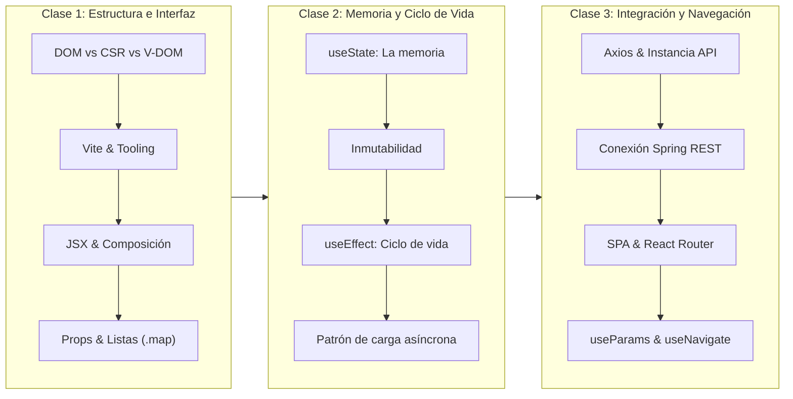

# Planeación Docente: Módulo de React (3 Sesiones de 2 Horas)
## Computación en Internet II — Universidad Icesi

> **Audiencia:** Estudiantes de Computación en Internet II con conocimientos previos en desarrollo backend con **Spring Boot** (APIs RESTful, DTOs, Spring Security con JWT en `@Order(1)` y MVC con Thymeleaf en `@Order(2)`).  
> **Duración Total:** 3 sesiones de 2 horas cada una (6 horas académicas).  
> **Enfoque Pedagógico:** *Hands-on incremental*. Migración progresiva de la interfaz web tradicional de gestión de cursos (renderizada en el servidor con Thymeleaf en `/cursos-mvc`) a una **Single Page Application (SPA)** desacoplada con **React + Vite + Axios + React Router**.

---

## 🗺️ Mapa de Ruta del Módulo



---

## 🟢 Clase 1: Fundamentos de React, Tooling con Vite y Arquitectura de Componentes

### 1. Objetivos de Aprendizaje
* Comprender la diferencia fundamental entre el renderizado del lado del servidor (SSR con Thymeleaf), la manipulación imperativa del DOM en Vanilla JS y el Client-Side Rendering (CSR) declarativo con Virtual DOM.
* Inicializar y explorar un proyecto React moderno utilizando **Vite** y entender el concepto de *Hot Module Replacement* (HMR).
* Diseñar componentes funcionales modulares utilizando sintaxis **JSX** y transferir datos unidireccionales mediante **Props**.
* Renderizar colecciones dinámicas de datos utilizando `.map()` y llaves (`key`).

### 2. Distribución Temporal (120 minutos)

| Bloque | Minutos | Actividad / Concepto | Metodología |
| :--- | :---: | :--- | :--- |
| **B1: Cambio de Paradigma** | 35 min | • Problemas del DOM imperativo (`document.querySelector`).<br>• SSR clásico vs CSR (La analogía del BBQ Coreano).<br>• Virtual DOM: Ciclo *Disparo $\rightarrow$ Render $\rightarrow$ Diff $\rightarrow$ Commit*. | Exposición conceptual con soporte gráfico en diapositivas. |
| **B2: Entorno y Vite** | 20 min | • Creación del proyecto con `npm create vite@latest`.<br>• Scripts (`dev`, `build`), HMR y arquitectura básica de `src/`. | Demostración en terminal y configuración guiada. |
| **B3: Live Coding Práctico** | 55 min | • Anatomía de un componente JSX y reglas de llaves `{}`.<br>• Creación de `Navbar.jsx`, `CursoCard.jsx` y `CursoList.jsx`.<br>• Inyección de datos estáticos desde `mockCursos.js`.<br>• Renderizado de listas con `.map()` y uso de la propiedad `key`. | Programación guiada paso a paso (*Code-along*). |
| **B4: Síntesis y Cierre** | 10 min | • Comparativa directa: `lista.html` (Thymeleaf) vs `CursoList.jsx`.<br>• Introducción a la pregunta: *¿Cómo hacemos que la UI recuerde datos que cambian?* | Preguntas socráticas de autoevaluación. |

### 3. Materiales de Apoyo y Referencias
* **Diapositivas (`slides/React/Material/introduccion-react.pdf`):**
  * **Slides 1 a 28 (Uso Obligatorio):** Explicación del DOM, CSR, analogía del BBQ Coreano (slides 12–19) y Virtual DOM (slides 20–28).
  * **Slides 29 a 43 (Uso Obligatorio):** Componentes, composición, Vite, scripts y HMR.
  * **Slides 44 a 52 (Mención Rápida):** Estructura de carpetas en `src/` (reducirla a `components/`, `data/` y `pages/` para no abrumar).
  * **Slides 53 a 68 (Uso Obligatorio):** Primer componente JSX, llaves y paso de props en listas.
* **Documentación en DocuKelo:**
  * [S14 — Introducción a React](https://docukelo-icesi.onrender.com/docs/computacion-2/semana-14/react-intro) (*Antes de React*, *Client Side Rendering*, *Componentes y composición*, *Props*).

### 4. Entregable Práctico de la Sesión
Un catálogo estático en `http://localhost:5173` que renderiza una cuadrícula de cursos académicos (`CursoCard`) a partir de `mockCursos.js`, encapsulados dentro de `CursoList` y acompañados por un `Navbar` institucional.

---

## 🟡 Clase 2: Hooks Fundamentales — Estado (`useState`) y Sincronización Externa (`useEffect`)

### 1. Objetivos de Aprendizaje
* Entender el ciclo de vida y la memoria interna de un componente funcional frente a la re-ejecución en cada render.
* Manipular estado local con **`useState`**, respetando el principio de **inmutabilidad** en colecciones y objetos.
* Dominar el concepto de **"El estado es una foto"** y las actualizaciones funcionales (`prev => prev + 1`).
* Comprender qué es un efecto secundario (*side-effect*) y cómo **`useEffect`** sincroniza el componente con el mundo exterior.
* Configurar correctamente el **arreglo de dependencias** y la **función de limpieza (*cleanup*)**.
* Implementar el patrón clásico de carga de datos (`isLoading`, `data`, `error`).

### 2. Distribución Temporal (120 minutos)

| Bloque | Minutos | Actividad / Concepto | Metodología |
| :--- | :---: | :--- | :--- |
| **B1: `useState` y Memoria** | 45 min | • ¿Por qué las variables locales `let` no sobreviven al render?<br>• Sintaxis `const [state, setState] = useState(initial)`.<br>• El estado es una foto y cola de actualizaciones de React.<br>• Inmutabilidad: Crear nuevos arreglos con spread operator (`...`). | Explicación interactiva + Live coding de un contador con trampas de mutación. |
| **B2: `useEffect` y Ciclo** | 40 min | • Funciones puras durante el render vs efectos secundarios.<br>• Setup, dependencias (`[]`, `[dep]`, sin arreglo) y limpieza.<br>• ¿Por qué corre dos veces en desarrollo? (`<StrictMode>`).<br>• Slide 39: El efecto para pedir datos. | Explicación teórica y demostración de consola. |
| **B3: Live Coding Práctico** | 25 min | • Búsqueda reactiva: Componente `CursoFiltro.jsx` con filtrado en tiempo real sin recargar la página.<br>• Formulario local de nuevo curso con inmutabilidad (`setCursos(prev => [nuevo, ...prev])`).<br>• Simulación de carga asíncrona con `setTimeout` dentro de `useEffect` (manejando spinner / mensaje de carga). | Programación guiada (*Code-along*). |
| **B4: Síntesis y Cierre** | 10 min | • Reto mental: ¿Qué pasa si la conexión al servidor falla o tarda? Introducción a peticiones HTTP reales. | Discusión guiada hacia Axios. |

### 3. Materiales de Apoyo y Referencias
* **Diapositivas (`slides/React/Material/semana-15-hooks-router.pdf`):**
  * **Slides 1 a 24 (Uso Obligatorio):** `useState`, memoria fuera de la función, el estado como foto, actualizaciones funcionales e inmutabilidad.
  * **Slides 25 a 40 (Uso Obligatorio):** `useEffect`, pureza, dependencias, limpieza, `<StrictMode>` y slide 39 (*Un efecto para pedir datos*).
  * **Slides 41 a 51 (Mención Opcional de 5 min):** *Custom Hooks*: Explicar conceptualmente que sirven para reutilizar lógica que combina `useState` y `useEffect`.
* **Documentación en DocuKelo:**
  * [S15 — React Hooks: useState, useEffect y custom hooks](https://docukelo-icesi.onrender.com/docs/computacion-2/semana-15/react-hooks).

### 4. Entregable Práctico de la Sesión
El catálogo de cursos ahora es completamente interactivo: permite filtrar cursos en tiempo real al escribir en un `<input>`, muestra un estado visual de carga antes de desplegar los datos y permite registrar nuevos cursos en el estado local sin recargar el navegador.

---

## 🔴 Clase 3: Consumo de APIs con Axios y Navegación SPA con React Router

### 1. Objetivos de Aprendizaje
* Reconocer las ventajas de **Axios** sobre la API nativa `fetch` (transformación automática de JSON, interceptores, manejo simplificado de errores HTTP).
* Configurar un cliente HTTP centralizado con `baseURL` y cabeceras de autorización JWT (`Bearer <token>`).
* Conectar el frontend en React con los endpoints REST del backend Spring Boot (`/api/v1/cursos`), gestionando respuestas exitosas y errores semánticos (ej. `409 Conflict`).
* Comprender la arquitectura de una **Single Page Application (SPA)** y el enrutamiento del lado del cliente.
* Implementar rutas dinámicas (`:id`) y lectura de parámetros con **`useParams`**.
* Implementar navegación declarativa con **`<Link>`** y navegación programática imperativa con **`useNavigate`**.

### 2. Distribución Temporal (120 minutos)

| Bloque | Minutos | Actividad / Concepto | Metodología |
| :--- | :---: | :--- | :--- |
| **B1: Consumo REST con Axios** | 50 min | • Comparativa `fetch` vs `axios`.<br>• Creación de `src/api/axiosConfig.js` (`baseURL` e interceptor JWT).<br>• Reemplazo del mock en `useEffect` por `api.get('/cursos')`.<br>• Petición `POST /cursos` para guardar en la base de datos.<br>• Manejo de errores con `try/catch` o `.catch()`. | Live coding conectando con el backend Spring Boot. |
| **B2: Enrutamiento con React Router** | 45 min | • Concepto de SPA y la pila del historial del navegador.<br>• Instalación de `react-router-dom` y configuración en `main.jsx` con `BrowserRouter`.<br>• Definición de rutas en `App.jsx` (`/cursos`, `/cursos/nuevo`, `/cursos/:id`).<br>• Navegación sin recargas con `<Link>` vs `<a href>`. | Exposición gráfica (slides 52–75) y estructuración de rutas. |
| **B3: Rutas Dinámicas y Navegación Imperativa** | 15 min | • Componente `CursoDetallePage.jsx` con `useParams()` para consultar el detalle del docente titular.<br>• Redirección con `useNavigate('/cursos')` tras guardar un nuevo curso en `CursoFormPage.jsx`. | Live coding integrador. |
| **B4: Síntesis Final del Módulo** | 10 min | • Cierre del ciclo: Frontend en React consumiendo API REST en Spring Boot con autenticación JWT. | Sesión de preguntas y conclusiones. |

### 3. Materiales de Apoyo y Referencias
* **Diapositivas (`slides/React/Material/semana-15-hooks-router.pdf`):**
  * **Slides 52 a 61 (Uso Obligatorio):** Qué es una SPA y por qué no recarga archivos.
  * **Slides 62 a 75 (Uso Obligatorio):** Rutas, `<Outlet>`, navegación con `<Link>` y comodín `*` (404).
  * **Slides 76 a 91 (Uso Obligatorio):** Pila del historial, `useNavigate`, `push` vs `replace`.
  * **Slides 92 a 98 (Uso Obligatorio):** Parámetros en URL (`:id`) y `useParams()`.
  * **Slides 99 a 109 (Omitir en clase):** Query params avanzados y *loaders* de React Router (se recomienda enfocarse en `useEffect` + Axios para no confundir dos formas distintas de pedir datos).
* **Documentación en DocuKelo:**
  * [S16 — Axios en React](https://docukelo-icesi.onrender.com/docs/computacion-2/semana-16/axios) (*¿Por qué Axios?*, *Instancia y configuración*, *Interceptores para JWT*, *CRUD*).
  * [S15 — React Router](https://docukelo-icesi.onrender.com/docs/computacion-2/semana-15/react-router) (*Una sola página*, *Link*, *Pila del historial*, *useParams*).

### 4. Entregable Práctico de la Sesión
Una SPA completa y funcional con tres pantallas conectadas al backend Spring Boot:
1. `/cursos`: Lista traída en vivo con `axios.get('/cursos')`.
2. `/cursos/:id`: Pantalla de detalle que muestra la información completa del curso y de su docente titular asignado.
3. `/cursos/nuevo`: Formulario de creación que envía un `axios.post('/cursos')` y redirige automáticamente al catálogo con `useNavigate`.

---

## 💻 Plan Detallado de Implementación Práctica (Live Coding)

### Arquitectura de Archivos a Desarrollar

```text
frontend-cursos/
├── index.html
├── package.json
├── vite.config.js
└── src/
    ├── main.jsx                 # Configuración de React y BrowserRouter
    ├── App.jsx                  # Rutas principales y layout general
    ├── api/
    │   └── axiosConfig.js       # (Clase 3) Instancia de Axios e interceptores
    ├── components/
    │   ├── Navbar.jsx           # (Clase 1) Barra de navegación superior
    │   ├── CursoCard.jsx        # (Clase 1) Tarjeta de presentación de curso
    │   ├── CursoList.jsx        # (Clase 1) Contenedor y mapeo de cursos (.map)
    │   └── CursoFiltro.jsx      # (Clase 2) Input controlado de búsqueda
    ├── pages/
    │   ├── CursosPage.jsx       # (Clase 3) Vista de catálogo general
    │   ├── CursoDetallePage.jsx # (Clase 3) Vista por ID con useParams()
    │   └── CursoFormPage.jsx    # (Clase 3) Vista de creación con useNavigate()
    └── data/
        └── mockCursos.js        # (Clase 1 y 2) Datos de respaldo inicial
```

---

### Código Base por Sesión

#### 1. Datos Mock Iniciales (`src/data/mockCursos.js`)
```javascript
export const MOCK_CURSOS = [
  {
    id: 1,
    nombre: "Computación en Internet II",
    creditos: 3,
    departamento: "Computación y Sistemas Inteligentes",
    profesor: "Kevin Rodriguez"
  },
  {
    id: 2,
    nombre: "Bases de Datos",
    creditos: 3,
    departamento: "Computación y Sistemas Inteligentes",
    profesor: "Claudia Martinez"
  },
  {
    id: 3,
    nombre: "Sistemas Distribuidos",
    creditos: 4,
    departamento: "TIC",
    profesor: "Andres Perez"
  }
];
```

#### 2. Componente de Presentación (`src/components/CursoCard.jsx`)
```jsx
import { Link } from 'react-router-dom';

export default function CursoCard({ curso }) {
  const { id, nombre, creditos, departamento, profesor } = curso;

  return (
    <div style={{
      border: '1px solid #e1e4e8',
      borderRadius: '8px',
      padding: '1.2rem',
      background: '#ffffff',
      boxShadow: '0 2px 4px rgba(0,0,0,0.05)'
    }}>
      <h3 style={{ margin: '0 0 0.5rem 0', color: '#002855' }}>{nombre}</h3>
      <p style={{ margin: '0.3rem 0', color: '#444' }}>
        <strong>Créditos:</strong> {creditos} · <strong>Depto:</strong> {departamento}
      </p>
      <p style={{ margin: '0.3rem 0', color: '#666' }}>
        👨‍🏫 <em>{profesor || 'Docente titular por asignar'}</em>
      </p>
      <div style={{ marginTop: '1rem' }}>
        <Link
          to={`/cursos/${id}`}
          style={{
            display: 'inline-block',
            background: '#0275d8',
            color: '#fff',
            padding: '0.4rem 0.8rem',
            borderRadius: '4px',
            textDecoration: 'none',
            fontSize: '0.9rem'
          }}
        >
          Ver Detalle
        </Link>
      </div>
    </div>
  );
}
```

#### 3. Búsqueda y Manejo de Estado (`src/components/CursoFiltro.jsx`)
```jsx
export default function CursoFiltro({ filtro, onFiltroChange }) {
  return (
    <div style={{ marginBottom: '1.5rem' }}>
      <input
        type="text"
        placeholder="🔍 Filtrar por nombre de curso o departamento..."
        value={filtro}
        onChange={(e) => onFiltroChange(e.target.value)}
        style={{
          width: '100%',
          padding: '0.7rem',
          borderRadius: '6px',
          border: '1px solid #ccc',
          fontSize: '1rem',
          boxSizing: 'border-box'
        }}
      />
    </div>
  );
}
```

#### 4. Instancia de Axios (`src/api/axiosConfig.js`)
```javascript
import axios from 'axios';

const api = axios.create({
  baseURL: 'http://localhost:8080/api/v1',
  headers: {
    'Content-Type': 'application/json'
  }
});

// Interceptor para inyectar token JWT si existe en el almacenamiento
api.interceptors.request.use((config) => {
  const token = localStorage.getItem('token');
  if (token) {
    config.headers.Authorization = `Bearer ${token}`;
  }
  return config;
});

export default api;
```

#### 5. Pantalla de Detalle con Parámetros Dinámicos (`src/pages/CursoDetallePage.jsx`)
```jsx
import { useParams, Link } from 'react-router-dom';
import { useState, useEffect } from 'react';
import api from '../api/axiosConfig';

export default function CursoDetallePage() {
  const { id } = useParams();
  const [curso, setCurso] = useState(null);
  const [isLoading, setIsLoading] = useState(true);
  const [error, setError] = useState(null);

  useEffect(() => {
    setIsLoading(true);
    api.get(`/cursos/${id}`)
      .then((res) => {
        setCurso(res.data);
        setError(null);
      })
      .catch((err) => {
        console.error(err);
        setError(`No se encontró información para el curso #${id}`);
      })
      .finally(() => setIsLoading(false));
  }, [id]);

  if (isLoading) return <p>⏳ Consultando detalles del curso #{id}...</p>;
  if (error) return <p style={{ color: 'red' }}>⚠️ {error}</p>;
  if (!curso) return null;

  return (
    <div style={{ maxWidth: '600px', margin: '0 auto', background: '#fff', padding: '2rem', borderRadius: '8px' }}>
      <Link to="/cursos" style={{ color: '#0275d8', textDecoration: 'none' }}>
        ← Volver a la Oferta Académica
      </Link>
      <h1 style={{ color: '#002855', marginTop: '1rem' }}>{curso.nombre}</h1>
      <p><strong>Créditos Académicos:</strong> {curso.creditos}</p>
      <p><strong>Departamento:</strong> {curso.departamento}</p>
      
      <div style={{ background: '#f8f9fa', padding: '1rem', borderRadius: '6px', borderLeft: '4px solid #002855', marginTop: '1.5rem' }}>
        <h4 style={{ margin: '0 0 0.5rem 0' }}>👨‍🏫 Información del Docente</h4>
        <p style={{ margin: '0.2rem 0' }}>{curso.profesorNombreCompleto || curso.profesor || 'Docente Titular'}</p>
        <p style={{ margin: '0.2rem 0', color: '#666' }}><small>{curso.profesorCorreo || 'docente@icesi.edu.co'}</small></p>
      </div>
    </div>
  );
}
```

---

## 📌 Recomendaciones de Infraestructura y Preparación para el Docente

1. **Configuración Previa de CORS en Spring Boot:**  
   Para evitar que las peticiones de Axios desde el puerto de desarrollo de Vite (`http://localhost:5173`) sean bloqueadas por el navegador con errores de `Access-Control-Allow-Origin`, asegúrate de habilitar CORS en `SecurityConfig.java`:
   ```java
   @Bean
   public CorsConfigurationSource corsConfigurationSource() {
       CorsConfiguration config = new CorsConfiguration();
       config.setAllowedOrigins(List.of("http://localhost:5173"));
       config.setAllowedMethods(List.of("GET", "POST", "PUT", "DELETE", "OPTIONS"));
       config.setAllowedHeaders(List.of("*"));
       UrlBasedCorsConfigurationSource source = new UrlBasedCorsConfigurationSource();
       source.registerCorsConfiguration("/**", config);
       return source;
   }
   ```
2. **Repositorio de Respaldo por Ramas:**  
   Crea ramas en Git (`sesion-1-final`, `sesion-2-final`, `sesion-3-final`) para que los estudiantes que tengan problemas de tipeo puedan sincronizarse rápidamente al inicio de cada clase.
3. **Fallback Offline sin Base de Datos:**  
   Si en la Clase 3 la base de datos PostgreSQL de algún estudiante no está iniciada, puede seguir utilizando `mockCursos.js` o un `json-server` rápido sin interrumpir su aprendizaje de React Router y Axios.
